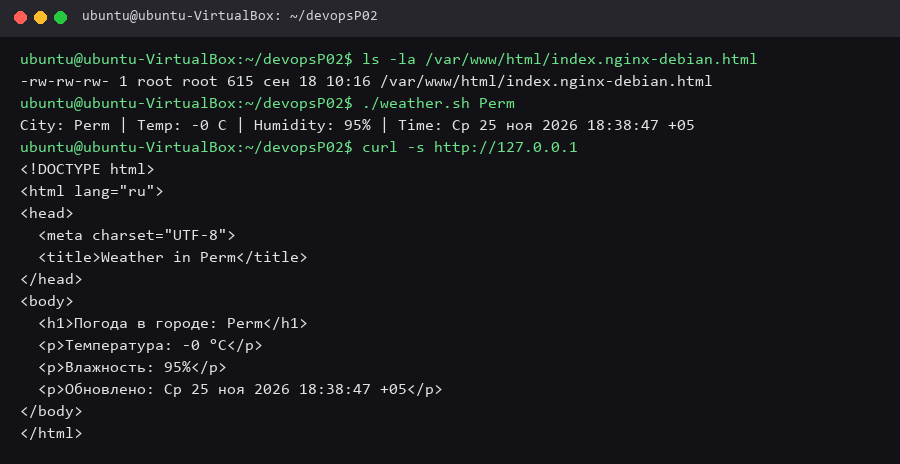
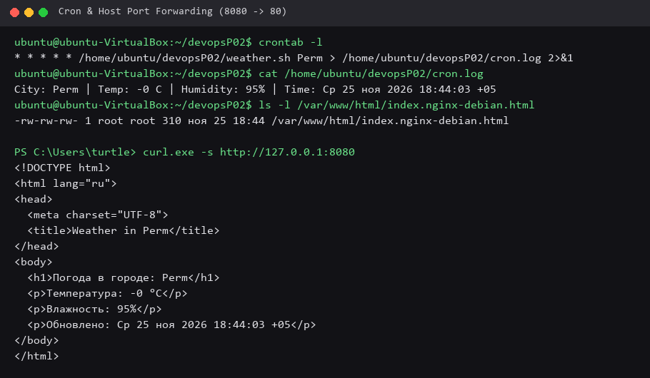

# П02. Автоматизация в Linux. Скрипты, Nginx и Cron

## Описание работы
Практическая работа №2 по курсу DevOps:
1. Написан bash-скрипт `weather.sh`, принимающий название города в качестве параметра (по умолчанию `Perm`).
2. Скрипт запрашивает текущие погодные данные в формате JSON через `https://wttr.in/<City>?format=j2`, извлекает температуру и влажность с помощью утилиты `jq` и формирует HTML-страницу.
3. Установлен и настроен веб-сервер **Nginx**, выданы права на запись в индексный файл `/var/www/html/index.nginx-debian.html`.
4. Настроен планировщик **cron** для запуска скрипта раз в минуту (`* * * * *`) с сохранением результата в дефолтный `index.nginx-debian.html` веб-сервера Nginx.
5. Настроен проброс портов в VirtualBox (`127.0.0.1:8080 -> 10.0.2.15:80`) и выполнена проверка через `curl` и браузер.

## Структура репозитория
* `README.md` — описание выполненной работы и отчёт со скриншотами.
* `weather.sh` — bash-скрипт получения погоды (`wttr.in` + `jq`) и обновления индексной страницы Nginx.
* `crontab.txt` — конфигурация задания планировщика cron.
* `screenshots/` — скриншоты, подтверждающие работу скрипта, cron и веб-сервера Nginx.

---

## Ход выполнения работы и результаты

### 1. Скрипт `weather.sh` и проверка вывода
Скрипт получает JSON от `wttr.in`, парсит поля `.current_condition[0].temp_C` и `.current_condition[0].humidity` через `jq` и записывает HTML в `/var/www/html/index.nginx-debian.html`:

```bash
chmod +x weather.sh
sudo chmod a+w /var/www/html/index.nginx-debian.html
./weather.sh Perm
curl http://127.0.0.1
```



---

### 2. Настройка планировщика cron и проверка с хоста
В `crontab -e` добавлена задача ежеминутного запуска скрипта:

```cron
* * * * * /home/ubuntu/devopsP02/weather.sh Perm > /home/ubuntu/devopsP02/cron.log 2>&1
```

После срабатывания cron проверены журнал выполнения, обновлённая страница Nginx и доступность веб-сервера с хостовой машины через проброшенный порт `8080`:


